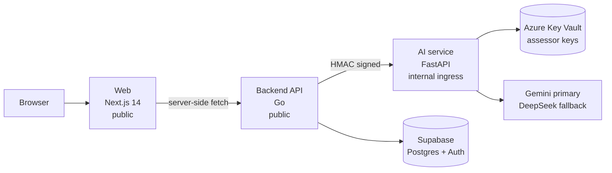
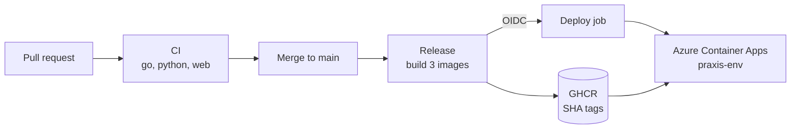

# Architecture

## Deploy flow

## Components

| Component | Runtime | Exposure | Notes |
|---|---|---|---|
| Web | Next.js 14, Node 20 | Public | Renders backend health server-side |
| Backend | Go 1.23 | Public | Signs every AI call with HMAC |
| AI | FastAPI, Python 3.12 | Internal ingress | Rejects unsigned `/internal` calls with 401 |
| Database | Supabase | Private | Go owns reads and writes |
| Secrets | Azure Key Vault | Private | Read by `praxis-ai` managed identity |

## Constraints

- The Container Apps environment is **express**. It has no VNet and does not support Key Vault secret references in app config, so the AI service reads Key Vault directly with its managed identity.
- Because express has no VNet, the AI service is reachable from the internet even with internal ingress. HMAC signing is the compensating control.
- Images are tagged with the full commit SHA and deployed automatically on merge to `main`.

See `docs/runbook.md` for deploy, rollback, and scaling commands.
