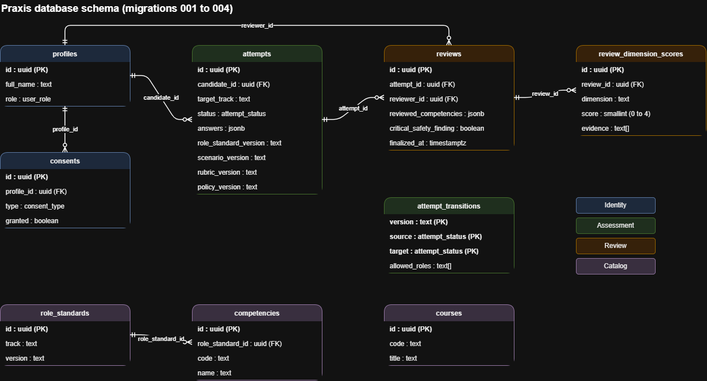

# Praxis database schema (ERD)

This page describes the Supabase (Postgres) schema built by migrations 001 to 004 in `supabase/migrations`. Go owns all reads and writes. The Python AI service stores nothing.

## How the data flows

1. A person signs up through Supabase Auth and a `profiles` row is created automatically with the role `candidate`.
2. Go creates an `attempts` row for a candidate. It records the role standard, scenario, rubric and policy versions used.
3. The attempt moves through the states below until a reviewer finalizes a `reviews` row.
4. Each review stores one `review_dimension_scores` row per rubric dimension, with evidence quotes.
5. Once a review is finalized, it and its scores can never be changed or deleted.

## Tables

### profiles
One row per user. `id` is the same as the Supabase Auth user id.

| Column | Type | Notes |
|---|---|---|
| id | uuid | Primary key, references auth.users |
| full_name | text | Optional |
| role | user_role | candidate, reviewer, employer or admin. Set from the server side only |
| created_at, updated_at | timestamptz | |

### consents
Append only record of what a user agreed to. A new row records each grant or withdrawal.

| Column | Type | Notes |
|---|---|---|
| id | uuid | Primary key |
| profile_id | uuid | Foreign key to profiles |
| type | consent_type | data_processing, cv_analysis or employer_sharing |
| granted | boolean | |
| recorded_at | timestamptz | |

### role_standards and competencies
Catalog data that mirrors the AI service catalog.

| Table | Columns | Notes |
|---|---|---|
| role_standards | id, track, version, created_at | Unique on (track, version) |
| competencies | id, role_standard_id, code, name | Unique on (role_standard_id, code). Codes such as C1 to C6 |

### courses
Catalog of learning modules: `id`, `code` (unique), `title`, `created_at`.

### attempts
One assessment attempt by a candidate.

| Column | Type | Notes |
|---|---|---|
| id | uuid | Primary key |
| candidate_id | uuid | Foreign key to profiles |
| target_track | text | For example operator or builder |
| role_standard_version, scenario_version, rubric_version, policy_version | text | Versions pinned when the attempt is created |
| status | attempt_status | See the state machine below. Defaults to assigned |
| answers | jsonb | Protected by row level security |
| submitted_at, created_at, updated_at | timestamptz | |

### attempt_transitions
The allowed moves of the attempt state machine (version 1.0.0 of the attempt states in the AI catalog).

| Column | Type | Notes |
|---|---|---|
| version, source, target | text, attempt_status, attempt_status | Primary key together |
| allowed_roles | text[] | Roles allowed to make the move |

### reviews
A reviewer's judgment of one attempt.

| Column | Type | Notes |
|---|---|---|
| id | uuid | Primary key |
| attempt_id | uuid | Foreign key to attempts |
| reviewer_id | uuid | Foreign key to profiles. Cannot equal the attempt's candidate |
| reviewed_competencies | jsonb | For example {"C1": 3, "C2": 4} |
| critical_safety_finding | boolean | |
| notes | text | |
| finalized_at | timestamptz | When set, the review is frozen |

### review_dimension_scores
The score for each rubric dimension of a review (accuracy, judgment, safety, communication).

| Column | Type | Notes |
|---|---|---|
| id | uuid | Primary key |
| review_id | uuid | Foreign key to reviews |
| dimension | text | Unique together with review_id |
| score | smallint | 0 to 4 |
| evidence | text[] | 1 to 10 quotes |

## Relationships

1. profiles has many consents.
2. profiles has many attempts (as candidate).
3. profiles has many reviews (as reviewer).
4. attempts has many reviews.
5. reviews has many review_dimension_scores.
6. role_standards has many competencies.

`attempt_transitions` and `courses` have no foreign keys. Attempts point to a role standard by its version text, not by a foreign key.

## Attempt state machine

Initial state: assigned. Only the moves below are allowed. The database rejects any other move. Voided is final.

| From | To | Allowed roles |
|---|---|---|
| assigned | in_progress | candidate |
| in_progress | submitted | candidate, system |
| submitted | under_review | reviewer |
| under_review | review_pending | reviewer |
| review_pending | under_review | reviewer |
| under_review | reviewed | reviewer |
| reviewed | under_review | admin |
| assigned, in_progress, submitted, under_review, review_pending | voided | admin |

## Rules enforced by the database

1. Row level security is on for every table. Anonymous users see nothing.
2. Candidates see only their own profile, consents, attempts and finalized reviews.
3. Reviewers see submitted attempts and their own reviews. Admins can read everything.
4. A user cannot change their own role.
5. A finalized review, and its dimension scores, cannot be changed or deleted.
6. Only one finalized review is allowed per attempt.
7. A reviewer cannot review their own attempt.
8. Illegal attempt state moves are rejected. Role checks apply to direct client access. The Go backend uses the service role, so Go must check roles itself.

## Migrations

| File | What it does |
|---|---|
| 001_init.sql | Core tables, signup trigger, immutable reviews |
| 002_rls.sql | Row level security policies |
| 003_attempt_states.sql | Adds the states assigned, review_pending and voided |
| 004_transitions_and_scores.sql | State machine table and trigger, per dimension scores, no self review rule |

## Planned next

1. Learning plans and their ordered modules.
2. Audit log (append only) and idempotency keys.
3. Referrals and capstone configurations.
