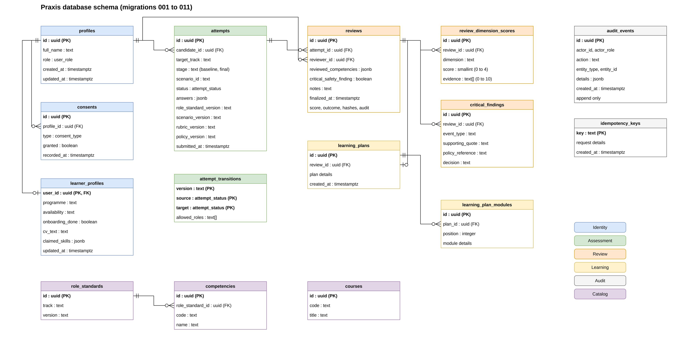

# Praxis database schema (ERD)

This page describes the Supabase (Postgres) schema built by migrations 001 to 011 in `supabase/migrations`. Go owns all reads and writes. The Python AI service stores nothing.

## How the data flows

1. A person signs up through Supabase Auth and a `profiles` row is created automatically with the role `candidate`.
2. The candidate can fill in a `learner_profiles` row (programme, availability, CV text, claimed skills). CV claims are only ever "claimed", never "verified".
3. A candidate starts their one baseline `attempts` row, or Go creates an attempt for them. It records the role standard, scenario, rubric and policy versions used.
4. The attempt moves through the states below until a reviewer finalizes a `reviews` row.
5. Each review stores one `review_dimension_scores` row per rubric dimension, plus any `critical_findings` the reviewer raised.
6. Once a review is finalized, it and its scores and findings can never be changed or deleted.
7. A reviewer can create a `learning_plans` row (with its `learning_plan_modules`) from a review.
8. Every important action writes an append-only `audit_events` row. `idempotency_keys` stop a repeated request from being applied twice.

## Tables

### profiles
One row per user. `id` is the same as the Supabase Auth user id.

| Column | Type | Notes |
|---|---|---|
| id | uuid | Primary key, references auth.users |
| full_name | text | Optional |
| role | user_role | candidate, reviewer, employer or admin. Set from the server side only |
| created_at, updated_at | timestamptz | |

### learner_profiles
Optional details a learner adds about themselves. One row per user. Deleting the profile deletes this row too.

| Column | Type | Notes |
|---|---|---|
| user_id | uuid | Primary key, foreign key to profiles |
| programme | text | |
| availability | text | |
| onboarding_done | boolean | Defaults to false |
| cv_text | text | Extracted CV text, checked and edited by the user. Never sent to the AI service |
| claimed_skills | jsonb | Claims only, never verified. Defaults to an empty list |
| created_at, updated_at | timestamptz | |

### consents
Append only record of what a user agreed to. A new row records each grant or withdrawal.

| Column | Type | Notes |
|---|---|---|
| id | uuid | Primary key |
| profile_id | uuid | Foreign key to profiles |
| type | consent_type | data_processing, cv_analysis or employer_sharing |
| granted | boolean | |
| recorded_at | timestamptz | |

### role_standards and competencies
Catalog data that mirrors the AI service catalog.

| Table | Columns | Notes |
|---|---|---|
| role_standards | id, track, version, created_at | Unique on (track, version) |
| competencies | id, role_standard_id, code, name | Unique on (role_standard_id, code). Codes such as C1 to C6, and B1 to B3 for builder |

### courses
Catalog of learning modules: `id`, `code` (unique), `title`, `created_at`.

### attempts
One assessment attempt by a candidate.

| Column | Type | Notes |
|---|---|---|
| id | uuid | Primary key |
| candidate_id | uuid | Foreign key to profiles |
| target_track | text | For example operator or builder |
| stage | text | baseline or final |
| scenario_id | text | The scenario the attempt uses, for example CS-01-A |
| role_standard_version, scenario_version, rubric_version, policy_version | text | Versions pinned when the attempt is created |
| status | attempt_status | See the state machine below. Defaults to assigned |
| answers | jsonb | Protected by row level security |
| submitted_at, created_at, updated_at | timestamptz | |

A candidate can have only one active baseline attempt (see rule 9 below).

### attempt_transitions
The allowed moves of the attempt state machine (version 1.0.0 of the attempt states in the AI catalog).

| Column | Type | Notes |
|---|---|---|
| version, source, target | text, attempt_status, attempt_status | Primary key together |
| allowed_roles | text[] | Roles allowed to make the move |

### reviews
A reviewer's judgment of one attempt.

| Column | Type | Notes |
|---|---|---|
| id | uuid | Primary key |
| attempt_id | uuid | Foreign key to attempts |
| reviewer_id | uuid | Foreign key to profiles. Cannot equal the attempt's candidate |
| reviewed_competencies | jsonb | For example {"C1": 3, "C2": 4} |
| critical_safety_finding | boolean | |
| notes | text | |
| finalized_at | timestamptz | When set, the review is frozen |

A review also stores the weighted score, the outcome, the rubric and scenario hashes, and audit fields (added in migration 005). Check `005_scenarios_findings_audit.sql` for the exact column names.

### review_dimension_scores
The score for each rubric dimension of a review (accuracy, judgment, safety, communication).

| Column | Type | Notes |
|---|---|---|
| id | uuid | Primary key |
| review_id | uuid | Foreign key to reviews |
| dimension | text | Unique together with review_id |
| score | smallint | 0 to 4 |
| evidence | text[] | Up to 10 quotes. A score of 2, 3 or 4 needs at least one quote. A score of 0 or 1 does not (migration 011) |

### critical_findings
A safety or policy problem a reviewer found in an attempt. Every finding must be confirmed or dismissed before the review can be finalized.

| Column | Type | Notes |
|---|---|---|
| id | uuid | Primary key |
| review_id | uuid | Foreign key to reviews |
| event_type | text | For example unauthorized_action |
| supporting_quote | text | The quote from the answers that supports the finding |
| policy_reference | text | For example POL-1 |
| decision | text | pending, confirmed or dismissed |

A confirmed critical finding means the attempt can never pass.

### learning_plans and learning_plan_modules
The training plan a reviewer creates from a finalized review, and its ordered modules.

| Table | Key columns | Notes |
|---|---|---|
| learning_plans | id, review_id | One plan per review. The candidate who owns the attempt can read it |
| learning_plan_modules | id, plan_id, position | The modules of a plan, in order |

Check `006_plans_audit_idempotency.sql` for the exact column names.

### audit_events
Append only log of who did what. Rows are never updated or deleted.

| Column | Type | Notes |
|---|---|---|
| id | uuid | Primary key |
| actor | uuid and role | Who did it |
| action | text | For example attempt.created, attempt.transition, profile.role_changed |
| entity_type, entity_id | text | What it was done to |
| details | jsonb | For example the old and new state |
| created_at | timestamptz | |

### idempotency_keys
Remembers requests that were already handled, so a repeated request is not applied twice. See `006_plans_audit_idempotency.sql` for the columns.

## Relationships

1. profiles has many consents.
2. profiles has one learner_profiles row.
3. profiles has many attempts (as candidate).
4. profiles has many reviews (as reviewer).
5. attempts has many reviews.
6. reviews has many review_dimension_scores.
7. reviews has many critical_findings.
8. reviews has one learning_plans row.
9. learning_plans has many learning_plan_modules.
10. role_standards has many competencies.

`attempt_transitions`, `courses`, `audit_events` and `idempotency_keys` have no foreign keys to the other tables. Attempts point to a role standard by its version text, not by a foreign key.

## Attempt state machine

Initial state: assigned. Only the moves below are allowed. The database rejects any other move. Voided is final.

| From | To | Allowed roles |
|---|---|---|
| assigned | in_progress | candidate |
| in_progress | submitted | candidate, system |
| submitted | under_review | reviewer |
| under_review | review_pending | reviewer |
| review_pending | under_review | reviewer |
| under_review | reviewed | reviewer |
| reviewed | under_review | admin |
| assigned, in_progress, submitted, under_review, review_pending | voided | admin |

An admin voids an attempt to reset a candidate's baseline. The candidate can then start a fresh one.

## Rules enforced by the database

1. Row level security is on for every table. Anonymous users see nothing.
2. Candidates see only their own profile, learner profile, consents, attempts, finalized reviews and plans.
3. Reviewers see submitted attempts and their own reviews. Admins can read everything.
4. A user cannot change their own role.
5. A finalized review, and its dimension scores and findings, cannot be changed or deleted.
6. Only one finalized review is allowed per attempt.
7. A reviewer cannot review their own attempt.
8. Illegal attempt state moves are rejected. Role checks apply to direct client access. The Go backend uses the service role, so Go must check roles itself.
9. A candidate can have only one active baseline attempt. A voided attempt does not count, so it can be restarted.
10. The audit log is append only.
11. A score of 2, 3 or 4 needs at least one evidence quote. A score of 0 or 1 does not.

## Migrations

| File | What it does |
|---|---|
| 001_init.sql | Core tables, signup trigger, immutable reviews |
| 002_rls.sql | Row level security policies |
| 003_attempt_states.sql | Adds the states assigned, review_pending and voided |
| 004_transitions_and_scores.sql | State machine table and trigger, per dimension scores, no self review rule |
| 005_scenarios_findings_audit.sql | scenario_id and stage on attempts, critical_findings table, audit fields on reviews |
| 006_plans_audit_idempotency.sql | learning_plans, learning_plan_modules, append only audit_events, idempotency_keys |
| 007_fix_signup_trigger.sql | Restores missing profiles columns and hardens the signup trigger |
| 008_one_baseline_per_candidate.sql | One baseline attempt per candidate (partial unique index). Replaced by 010 |
| 009_learner_profiles.sql | learner_profiles table with row level security |
| 010_baseline_allow_reset.sql | One active (not voided) baseline per candidate, so an admin can reset a baseline |
| 011_relax_evidence_for_low_scores.sql | Scores of 0 or 1 no longer need an evidence quote |

## Planned next

1. Account deletion and data cleanup (the learner profile is already removed with the profile).
2. Badge and certificate state.
3. Referrals and capstone configurations.
